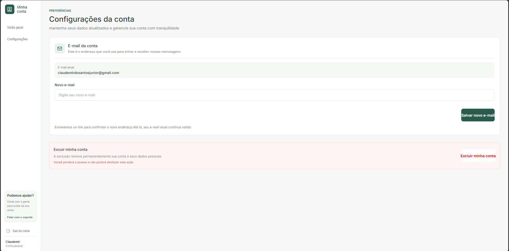

# AuthSpace - Frontend

Frontend de uma aplicação de autenticação e gerenciamento de conta, desenvolvido com React e TypeScript.

O AuthSpace foi criado com o objetivo de praticar o desenvolvimento de interfaces web, organização de componentes e integração com uma API backend própria.

O projeto possui telas de login, registro de usuário, dashboard e configurações da conta, incluindo funcionalidades relacionadas ao gerenciamento de dados do usuário.

## Tecnologias utilizadas

- React
- TypeScript
- CSS Modules
- React Router DOM

## Funcionalidades

- Tela de login
- Cadastro de usuários
- Dashboard
- Configurações da conta
- Alteração de e-mail
- Exclusão de conta
- Integração com API backend

## Telas do projeto

### Login

<!-- Adicione aqui o print da tela de login -->


### Cadastro

<!-- Adicione aqui o print da tela de cadastro -->


### Dashboard

<!-- Adicione aqui o print da tela principal -->


### Configurações da conta

<!-- Adicione aqui o print da tela de configurações -->



## Backend

O frontend se comunica com uma API desenvolvida separadamente, responsável pelo processamento das requisições e gerenciamento dos dados.

**Repositório do backend:**

[AuthSpace-Backend](https://github.com/Claudemir786/AuthSpace-Backend)

## Como executar o projeto

### 1. Clone o repositório

```bash
git clone https://github.com/Claudemir786/AuthSpace-Frontend.git
```

### 2. Acesse a pasta do projeto

```bash
cd AuthSpace-Frontend
```

### 3. Instale as dependências

```bash
npm install
```

### 4. Execute o projeto

```bash
npm run dev
```

O frontend será iniciado localmente. Para utilizar as funcionalidades que dependem da API, é necessário que o backend esteja configurado e em execução.

## Objetivo

Este projeto faz parte dos meus estudos em desenvolvimento web e tem como objetivo aprofundar meus conhecimentos em React, TypeScript, criação de interfaces e integração entre frontend e backend.

---

Desenvolvido por [Claudemir Junior](https://github.com/Claudemir786)